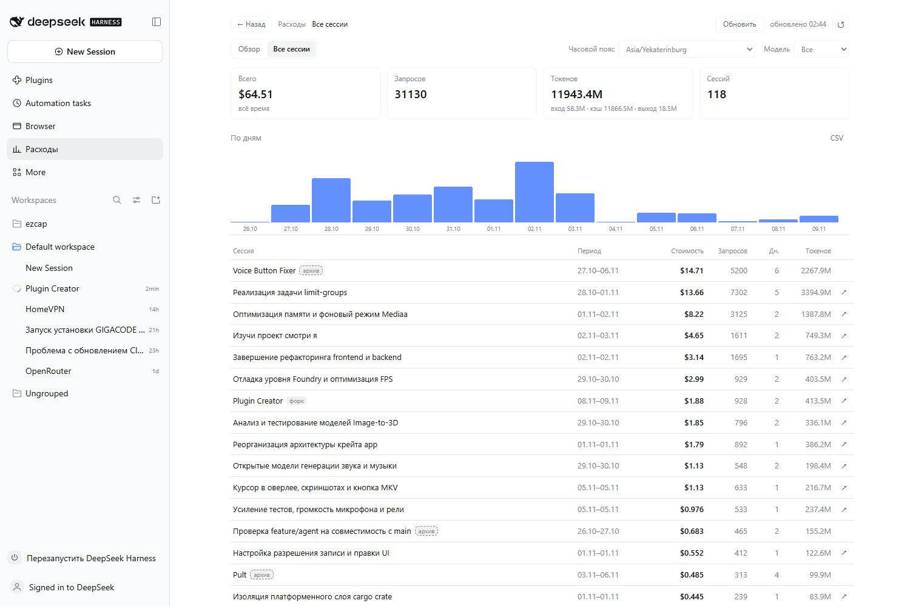
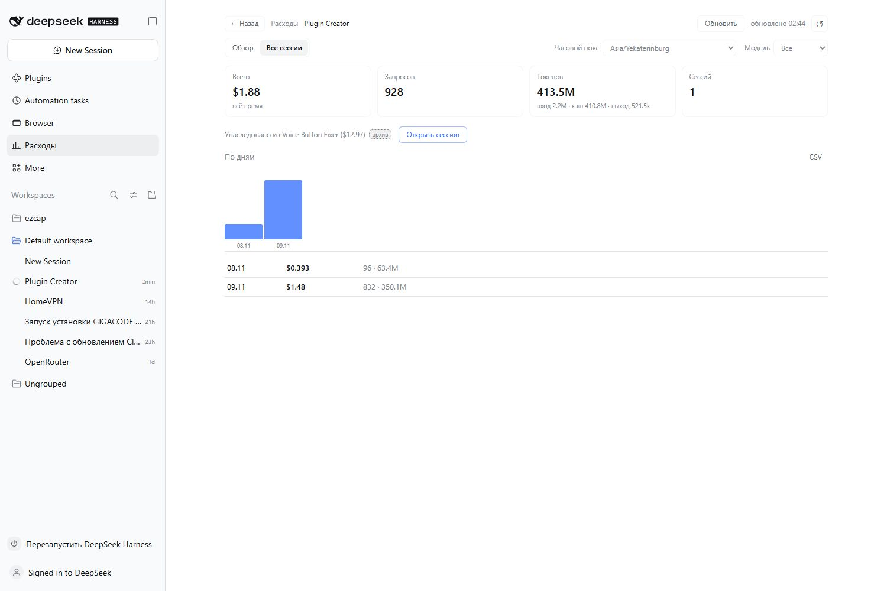

# dsh-pricing

DeepSeek peak hours, live token prices and the real spend of every chat — right in
the DSH session header, plus a full spending analytics page.

The chip answers one question: **is it expensive right now, and until when**. It
is shown only for the official DeepSeek provider; other providers and local models
get no chip at all.

```
Plugin Creator   ⚙ Standard mode        [ ● сессия $1.60 ]      📁 ⋯
during peak hours:
                                        [ ● ПИК · сессия $1.60 · до 09:00 ]
```

## Screenshots






## What you get

- **Header chip** — the actual spend of the current session only (`● сессия $1.60`).
  During peak hours it turns red and adds `ПИК` plus the end time; the chip label
  stays in the plugin language.
- **Hover card** — the provider's peak schedule in its own zone and in yours, the
  time left, a four-row price table (peak and off-peak for both models: input,
  cache hit, output), the session spend with a token breakdown, an inherited-fork
  note and a «Refresh now» action.
- **Settings** — interface language: Russian, English, Chinese or «Auto» (the
  application language). Stored in `%LOCALAPPDATA%\dsh-pricing\settings.json`.
- **Spending page** — a sidebar section with periods, charts, session tables,
  per-session details and CSV export.

## Languages

Strings live in `client.js` (`STRINGS.ru|en|zh`), plugin-list titles in
`locale/*.json`. The language is switched in **Plugins → dsh-pricing** and written
to the same settings file. Precedence: the stored setting (`ru`, `en`, `zh`) →
`auto`, which follows `document.documentElement.lang` / `navigator.language` →
the default `ru`.

## Where prices come from

`https://api-docs.deepseek.com/quick_start/pricing.md` — the docs page is available
as markdown, so it is parsed without an HTML parser.

The host half:

- fetches the page every `refreshHours` (6 by default) and parses the `PRICING`
  table and the `Peak hours are …` sentence;
- **validates** the result: all three metrics for both models, `peak ≥ off > 0`.
  An incomplete table is rejected and the previous snapshot stays;
- caches the last good snapshot in `%LOCALAPPDATA%\dsh-pricing\prices.json`;
- serves it over loopback `127.0.0.1:49237` (`/state`, `/refresh`, `/settings`,
  `/analytics`, `/session-cost`, `/health`);
- writes diagnostics to `%LOCALAPPDATA%\dsh-pricing\plugin.log`.

`data/pricing.json` ships as a reference snapshot, so the plugin works offline and
on the very first start.

## Session spend

The provider returns tokens, not money. Spend is therefore computed **from the
actual tokens in the durable session log**: every `assistant/message` and
`compaction/summary` record with `usage` (uncached input, cache reads, cache
writes, output) is priced with the tariff **in force at that record's own
timestamp** — peak or off-peak. Old peak turns stay priced at the peak rate even
when the current period is off-peak.

Parsed logs are cached by path/size/mtime, so polling never re-reads an unchanged
file. The chip shows the session cost; the card shows the same number with a token
breakdown.

## Reset point

The card has two slices: **Session** (the whole chat) and **Since the last reset**
(only what accumulated after pressing «Reset»).

- «Reset» stores the moment (and the request number it happened at) for the current
  session; the second counter starts from there.
- The total is never erased: «Session» stays complete.
- The chip always shows the reset slice: before any reset it equals the whole chat.
- «Clear reset» removes the marker, both slices align again.
- Resets are per chat, stored in `%LOCALAPPDATA%\dsh-pricing\resets.json` and
  survive restarts.

## Time zones

Peak windows are stored in the publishing zone (`peak.tz`, currently `UTC`),
compared as absolute instants through `Intl`, and displayed in your local zone.
DeepSeek peaks: `01:00–04:00` and `06:00–10:00 UTC`, Monday to Friday, excluding
Chinese public holidays; for UTC+5 that is `06:00–09:00` and `11:00–15:00`.

Holidays are a list of ISO dates in `peak.holidays` (empty by default: the provider
publishes no machine-readable calendar, dates are added by hand).

## Spending page

The **Spending** section in the sidebar is a dedicated page:

- **Overview** — period presets (calendar week default, month, 30 days, a single
  day, a custom range), KPI cards, a day chart and the session list for that
  period.
- **All sessions** — the full list for all time, sorted by cost, with lifetime,
  cost, requests, active days and tokens; loaded 100 at a time.
- **Custom range** — one Monday-first calendar: first click sets the start, second
  sets the end; clicking another date starts a new range.
- **Time zone selector** — affects grouping only: each request is priced by its own
  instant, so the same date in different zones yields different request sets.
- **Charts** — days for any period; for a single selected day the chart switches to
  hours (0–23). Hovering a bar shows its date, sum and request count immediately.
- **Toolbar** — «Refresh» rebuilds the index, the last build time is shown next to
  it, «Reset view» returns to the default view.
- **Navigation** — breadcrumbs with a back stack (up to 20 steps) and ‹ › arrows for
  day/week/month.
- **Session detail** — the whole lifetime of one session, its days, hours and an
  «Open session» button.
- **CSV** — export of the selected period or session.

The host keeps an index in `%LOCALAPPDATA%\dsh-pricing\analytics.json`: per log the
size, mtime and a compact record list. Only changed logs are reparsed; the build
runs in the background, and a five-minute pass keeps the index close to the live
logs.

## Session types

- **fork** — a user fork: a copy of the parent history (the parent id comes from the
  log header).
- **subagent** — a session created by a sub-agent (`delegationDepth > 0`).

They are different things and never mixed in the UI.

## Forked sessions

A fork copies the parent history, and its log contains the same `usage` records
with the original timestamps. Those requests were already paid in the parent, so
the analytics never bills them twice:

- the inherited event count comes from the projection cache
  (`identity.inheritedEventCount`), the parent id from the log header
  (`parentSession`);
- records whose `seq` is at or below that count are aggregated as `inherited`;
- a fork's cost and tokens cover only its own requests, so charts stay honest;
- the session card shows «Inherited from … ($X)»; the name is a link only when the
  parent still exists and is not archived.

If the parent log was deleted, its part is simply absent — only what exists on disk
is counted.

## Links and archives

Every session row may carry an open arrow (↗) and the card has an «Open session»
button, but only for sessions present in the live DSH sidebar and not archived.
Sessions that are archived keep their row with an «archive» badge and no link at
all; clicking does nothing, so a removed or archived session can never open a blank
chat.

## One shared ledger

Log parsing, per-request tariff pricing and the inherited-prefix split live in one
module, `ledger.js`. Both the header chip (`/session-cost`) and the spending page
(`/analytics`) read through it, so the numbers agree everywhere.

## Install

```bash
npx --yes github:machine202502/dsh-pricing
# or in a DSH profile: npm i github:machine202502/dsh-pricing
```

## Config (`cordis.patch.yml`)

```yaml
- id: pricing
  name: 'dsh-pricing'
  config:
    bridgePort: 49237
    refreshHours: 6
    sourceUrl: 'https://api-docs.deepseek.com/quick_start/pricing.md'
    officialProviders: [deepseek-account]
    models: [deepseek-flash, deepseek-v4-flash, deepseek-v4-pro]
```

## Limitations

- Search and Fetch API calls are billed per request ($0.75 per 1,000), not per
  token, so they are not part of the token spend.
- Deleted session logs cannot be priced; only logs on disk are counted.
- If the provider changes the page markup, the snapshot is not applied and the
  plugin keeps the last verified prices (the failure goes to the log).
- Chinese public holidays are manual: add ISO dates to `peak.holidays` when needed.
