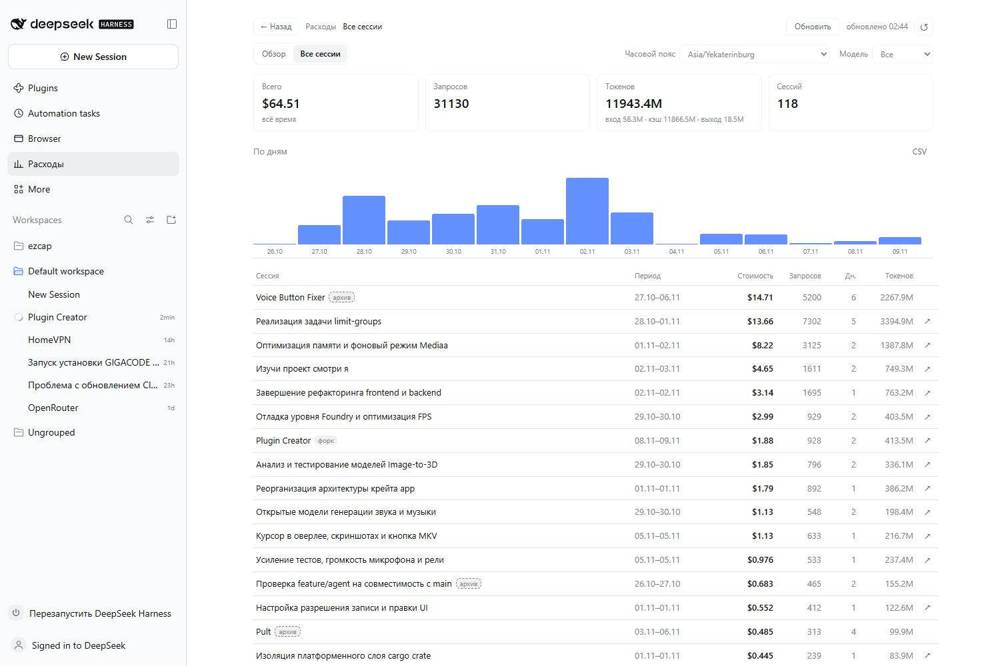
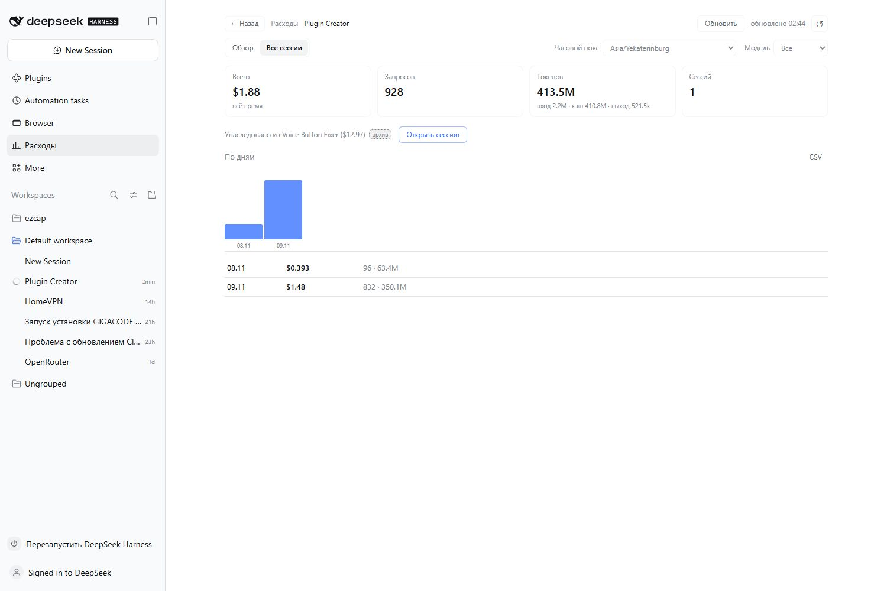

# dsh-pricing

Пиковые часы DeepSeek, актуальные цены токенов и реальный расход каждого чата —
прямо в шапке сессии DSH, плюс отдельная страница аналитики расходов.

Плашка отвечает на один вопрос: **сейчас дорого или нет и до когда**. Показывается
только для официального провайдера DeepSeek; у сторонних и локальных моделей слота
нет.

```
Plugin Creator   ⚙ Standard mode        [ ● сессия $1.60 ]      📁 ⋯
во время пика:
                                        [ ● ПИК · сессия $1.60 · до 09:00 ]
```

## Скриншоты






## Что показывает

- **Пилюля в шапке** — только фактическая стоимость текущей сессии (`● сессия $1.60`).
  В пик становится красной, добавляет `ПИК` и время окончания.
- **Карточка по наведению** — расписание пика в поясе провайдера и в вашем местном,
  сколько осталось, таблица цен на четыре строки (пик и вне пика для обеих моделей:
  вход, кэш-хит, выход), стоимость сессии с разбивкой по токенам, строка про
  унаследованный форк и кнопка «Обновить сейчас».
- **Настройки** — язык интерфейса: русский, английский, китайский или «Авто» (язык
  приложения). Хранится в `%LOCALAPPDATA%\dsh-pricing\settings.json`.
- **Страница «Расходы»** — секция в сайдбаре: периоды, графики, таблицы сессий,
  карточка сессии и выгрузка CSV.

## Языки

Строки лежат в `client.js` (`STRINGS.ru|en|zh`), названия плагина в списке — в
`locale/*.json`. Язык меняется в **Plugins → dsh-pricing** и пишется в тот же файл
настроек. Приоритет: сохранённая настройка (`ru`, `en`, `zh`) → `auto`
(`document.documentElement.lang` / `navigator.language`) → дефолт `ru`.

## Откуда данные

`https://api-docs.deepseek.com/quick_start/pricing.md` — страница документации в
markdown, разбирается без HTML-парсера.

Хост-часть:

- раз в `refreshHours` (по умолчанию 6 ч) забирает страницу, парсит таблицу
  `PRICING` и фразу `Peak hours are …`;
- **валидирует** результат: все три метрики у обеих моделей, `peak ≥ off > 0`.
  Неполная таблица не применяется, остаётся прошлый снимок;
- кэширует удачный снимок в `%LOCALAPPDATA%\dsh-pricing\prices.json`;
- отдаёт данные по loopback `127.0.0.1:49237` (`/state`, `/refresh`, `/settings`,
  `/analytics`, `/session-cost`, `/health`);
- пишет диагностику в `%LOCALAPPDATA%\dsh-pricing\plugin.log`.

В комплекте — `data/pricing.json`, эталонный снимок: плагин работает без сети и при
первом запуске.

## Стоимость сессии

Провайдер отдаёт токены, а не деньги. Поэтому стоимость считается **по фактическим
токенам из журнала сессии**: каждая запись `assistant/message` и
`compaction/summary` с `usage` (вход без кэша, кэш-чтения, кэш-записи, выход)
оценивается по тарифу **на момент этого запроса** — пиковому или внепиковому.
Старые пиковые ходы остаются по пиковой цене, даже если сейчас вне пика.

Разобранные журналы кэшируются по пути/размеру/mtime, поэтому повторный опрос не
перечитывает неизменившийся файл. Пилюля показывает стоимость сессии, карточка —
ту же сумму с разбивкой по токенам.

## Точка сброса

В карточке два среза: **«Сессия»** — весь расход чата, и **«С последнего сброса»** —
только то, что набежало после нажатия «Сбросить».

- «Сбросить» запоминает момент (и номер запроса) для текущей сессии, второй счётчик
  начинает с него.
- Общий расход не стирается: «Сессия» остаётся полной.
- В пилюле всегда значение сброса: пока сброса не было, это весь чат.
- «Снять сброс» убирает отметку, счётчики снова совпадают.
- Сброс свой у каждого чата, хранится в `%LOCALAPPDATA%\dsh-pricing\resets.json` и
  переживает перезапуск.

## Часовые пояса

Окна пика хранятся в поясе публикации (`peak.tz`, сейчас `UTC`), сравниваются по
абсолютным моментам через `Intl`, показываются в вашем поясе. У DeepSeek пик:
`01:00–04:00` и `06:00–10:00 UTC`, Пн–Пт, кроме китайских праздников; для UTC+5 это
`06:00–09:00` и `11:00–15:00`.

Праздники — список ISO-дат в `peak.holidays` (пуст по умолчанию: машинного
календаря у провайдера нет, даты добавляются вручную).

## Страница «Расходы»

- **Обзор** — периоды (по умолчанию календарная неделя, плюс месяц, 30 дней, один
  день и свой диапазон), KPI, график по дням и список сессий за период.
- **Все сессии** — весь список за всё время, по убыванию стоимости: период жизни,
  стоимость, запросы, активные дни, токены; грузится по 100.
- **Свой диапазон** — один календарь с понедельника: первый клик задаёт начало,
  второй конец; клик по другой дате начинает новый диапазон.
- **Часовой пояс** — влияет только на группировку: цена запроса считается по его
  собственному моменту, поэтому одна и та же дата в разных зонах даёт разные наборы
  запросов.
- **Графики** — дни для любого периода; для одного выбранного дня график
  переключается на часы (0–23). Наведение на столбик сразу показывает дату, сумму и
  число запросов.
- **Тулбар** — «Обновить» пересобирает индекс, рядом время последней сборки,
  «Сбросить вид» возвращает вид по умолчанию.
- **Навигация** — хлебные крошки с историей назад (до 20 шагов) и стрелки ‹ › для
  дня, недели и месяца.
- **Карточка сессии** — весь срок жизни, дни, часы и кнопка «Открыть сессию».
- **CSV** — выгрузка периода или сессии.

Хост держит индекс в `%LOCALAPPDATA%\dsh-pricing\analytics.json`: по каждому журналу
размер, mtime и компактный список записей. Пересчитываются только изменившиеся
журналы, сборка идёт в фоне, а пятиминутный проход держит индекс близко к живым
логам.

## Типы сессий

- **форк** — пользовательский форк, копия истории родителя (родитель берётся из
  заголовка журнала);
- **сабагент** — сессия, созданная суб-агентом (`delegationDepth > 0`).

Это разные вещи, в интерфейсе они не смешиваются.

## Суб-агентские сессии

Сессия, созданная суб-агентом, — это отдельный чат со своим журналом. Плагин
считает её частью чата, который её породил:

- **плашка и её карточка** всегда показывают весь чат: собственные запросы плюс
  все суб-агентские сессии (рекурсивно), и строку «включая суб-агентов: $X · N»;
- **страница «Расходы»** имеет переключатель «Разбивка по суб-агентам», по
  умолчанию выключенный:
  - выключен — суб-агентские сессии сворачиваются в строку родителя, каждый чат
    показывает полную стоимость;
  - включён — суб-агентские сессии становятся отдельными строками, а их стоимость
    вычитается из строки родителя, чтобы ничего не посчиталось дважды.

## Форки сессий

Форк копирует историю родителя, и в его журнале лежат те же записи `usage` с
исходными временами. Эти запросы уже оплачены в родителе, поэтому аналитика не
суммирует их повторно:

- число унаследованных событий берётся из кэша проекций
  (`identity.inheritedEventCount`), родитель — из заголовка журнала (`parentSession`);
- записи с `seq` не больше этого числа попадают в отдельный агрегат `inherited`;
- стоимость и токены форка считаются только по его собственным запросам;
- в карточке видно «Унаследовано из … ($X)», имя — ссылка только если родитель
  существует и не в архиве.

Если журнал родителя удалён, его часть просто отсутствует — считаем только то, что
есть на диске.

## Ссылки и архив

У каждой живой сессии есть стрелка ↗ в строке и кнопка «Открыть сессию» в карточке.
Архивные и удалённые сессии остаются в таблице со значком «архив», но без ссылки:
клик ничего не делает, пустой чат не открывается.

## Один общий расчёт

Разбор журналов, тарифы по времени запроса и отделение унаследованного префикса
живут в одном модуле — `ledger.js`. Через него считают и плашка (`/session-cost`), и
страница «Расходы» (`/analytics`), поэтому цифры везде совпадают.

## Установка

```bash
npx --yes github:machine202502/dsh-pricing
# или в профиле DSH: npm i github:machine202502/dsh-pricing
```

## Конфиг (`cordis.patch.yml`)

```yaml
- id: pricing
  name: 'dsh-pricing'
  config:
    bridgePort: 49237
    refreshHours: 6
    sourceUrl: 'https://api-docs.deepseek.com/quick_start/pricing.md'
    officialProviders: [deepseek-account]
    models: [deepseek-flash, deepseek-v4-flash, deepseek-v4-pro]
```

## Ограничения

- Вызовы Search и Fetch биллингуются за запрос ($0.75 за 1 000), а не за токены,
  поэтому в стоимость токенов не входят.
- Удалённые журналы посчитать нельзя — считаем только логи на диске.
- Если провайдер сменит разметку страницы, снимок не применится, плагин останется
  на последних проверенных ценах (сбой попадёт в лог).
- Китайские праздники задаются вручную: даты добавляются в `peak.holidays`.
